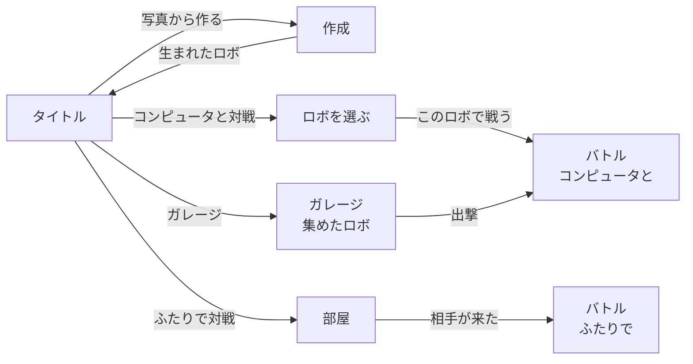
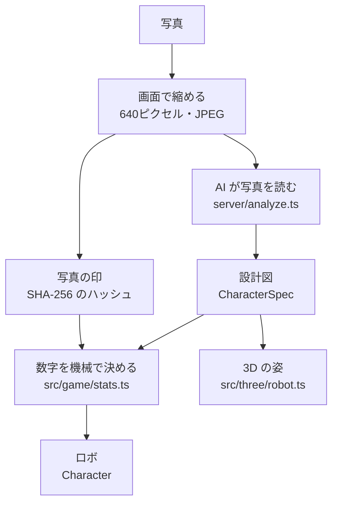

# ピクセル・バトラー ― コンセプトと設計

2026-11-23 時点の、ゲームの考え方と作りをまとめたもの。
動かし方・本番に出す手順は [README.md](../README.md)、作業のきまりは [CLAUDE.md](../CLAUDE.md) にある。
このファイルはリポジトリといっしょに公開されるので、鍵・家族のこと・特別な写真の条件は書かない。

---

## 1. ひとことで

**写真を撮ると、その写真から自分だけの SD ロボが生まれ、コマンドを選んで戦うブラウザゲーム。**

昔のおもちゃ「バーコードバトラー」の「読みこんで → 生まれて → 戦う」を、AI と 3D と演出で今の形にしたもの。
バーコードの代わりに、身の回りの写真を使う。

## 2. コンセプト

### だれのためのゲームか

- **メインの遊び手は小学6年生。** 家族（親・兄弟）と、その友達も遊ぶ
- スマホのブラウザで遊ぶ。アプリを入れなくてよい
- Google でログインすれば、だれでも遊べる（作れる回数には上限がある）

### 遊びの芯（いちばん大事にしている気持ち）

1. **「これを撮ったら、何が生まれる？」** ― 身の回りのものを撮りたくなる。リンゴ・自転車・ねこ・スニーカー…何でもロボになる
2. **「あの写真のあれだ」と分かる** ― ロボの名前・色・形・技が、写真のモチーフ（主役）とつながっている
3. **「自分のロボ」への愛着** ― 同じ写真からは、いつも同じロボが生まれる。ガレージに集めて、どのスマホからでも呼び出せる
4. **当たりの写真がある** ― ランク（S/A/B/C）は写真ごとに決まる。バーコードバトラーの「強いバーコード探し」と同じ楽しみ
5. **戦いはかんたん、でも見ていて楽しい** ― コマンドは4つだけ。そのぶん、3D の動き・必殺技のカットイン・音で盛り上げる

### 大事にしているきまり

- **強さは公平に。** AI は見た目と性格を決めるだけで、数字は機械が決める。AI の気まぐれで強すぎるロボが出ないようにするため
- **子どもが読める言葉で。** 画面の言葉は、小学校で習う漢字（1026字）とひらがな・カタカナだけ（→ 11章）
- **知らない人とも会う場所では、写真を出さない。** ふたりで対戦で見せるのはロボの名前と姿だけ
- **遊べなくならない。** AI につながらないときは、写真の色だけからロボを作る

## 3. 遊びの流れ（画面）



| 画面 | ファイル | 中身 |
|---|---|---|
| タイトル | `src/ui/Title.tsx` | うしろに、いちばん新しいロボを出す。部屋にだれかが待っているかも出す |
| 作成 | `src/ui/Create.tsx` | 写真を選ぶ → 読みとりの演出 → カード（`CharacterCard.tsx`）で紹介 |
| ガレージ | `src/ui/Hangar.tsx` | 集めたロボの一覧。選ぶと 3D で見られる。消せる |
| ロボを選ぶ | `src/ui/Hangar.tsx`（`pick`） | 「コンピュータと対戦」で、戦うロボを選ぶ。ガレージと同じ画面で、消すボタンは出さない |
| バトル | `src/ui/Battle.tsx` | コンピュータとも、ふたりで対戦も、同じ画面 |
| 部屋 | `src/ui/Room.tsx` | ふたりで対戦の待ち合わせ |
| ならべて見る | `src/ui/Showroom.tsx` | 開発中だけ（`?showroom`）。ロボの見た目の確かめ用 |

分かりにくい言葉（HP・SP・属性・特性など）には、タップすると出る説明の吹き出しがある（`src/ui/Term.tsx`・`src/game/glossary.ts`）。

## 4. ロボが生まれるしくみ



### 写真の印（ハッシュ）

- 写真を 640ピクセルに縮めた JPEG から作る、64文字の目印（`src/lib/image.ts`）
- **同じ写真なら、いつも同じ印。** 印は、同じロボを見分けるため・強さを決めるさいころの種・設計図の取り置きの名前に使う
- 同じ物でも、撮り直せば別の写真なので、別のロボになる

### AI が決めるもの（設計図）

AI（OpenAI。既定は `gpt-6-luna`、だめなら `gpt-4.1-mini`）に写真を見せて、決まった形の JSON で答えてもらう。

| 項目 | 中身 |
|---|---|
| motif | 写真の主役（例：赤いリンゴ） |
| name・title・description | 名前（カタカナ3〜8字）・二つ名・紹介文 |
| form | 体の形：人型・けもの型・空中型 |
| element | 属性：火・水・森・光・夜 |
| parts | 頭・胴・腕・脚・背中・武器の部品の種類 |
| colors | 本体・差し色・金属・目の光の色 |
| bias | HP・SP・こうげき・ぼうぎょの**傾向**（1〜5。合計10〜14） |
| skill・ultimate・trait | スキルの種類と名前・必殺技の型と名前と叫び・特性 |

- AI が選べるのは、決まった選択肢の中からだけ。答えは `src/game/spec.ts`（`sanitizeSpec`）で整える（字数を切る・知らない値は既定に戻す）
- **同じ写真には、同じ設計図を返す。** 一度作った設計図は取っておく（本番は Firestore の `specs`、手元は `.cache/specs/`）。2回目からは AI を呼ばず、作れる回数にも数えない
- AI への指示を大きく変えたら `CACHE_VERSION`（いまは `k2`）を上げる。前の指示で作った設計図を返さないため

### 習わない漢字への手当て

AI には「小学校で習う漢字だけ」と頼んでいるが、守られないことがある。そこで三段がまえにしている。

1. 写真から作ったあと、習わない漢字が入っていたら、その字を名指しして写真から一度作り直す
2. それでも残ったら、**文だけ**を AI に書き直してもらう（写真は送らない。最大2回。強さ・見た目・名前は変えない）
3. 漢字の決まりを入れる前（2026-11-22 の昼）に作ったロボは、ガレージを開いたときに、2 と同じやり方で一体につき一度だけ直す（`/api/robots/fix`）

### AI につながらないとき

写真のいちばん目立つ色から、属性・部品・技をさいころで決めて作る（`src/game/fallback.ts`）。名前も技もさいころで決まる。

## 5. 強さのきまり

`src/game/stats.ts`。**同じ写真なら、だれが・どのスマホで作っても、同じ強さ。**

- **総合力**：写真の印をさいころの種にして、92〜108 のどこかに決まる
- **ランク**：総合力で決まる。105以上＝S、100以上＝A、96以上＝B、それより下＝C
- **4つの数字**：総合力を、AI が選んだ傾向（bias）＋少しのゆれで HP・SP・こうげき・ぼうぎょに分ける。一つにかたよりすぎないように、取り分には上限と下限がある

| 数字 | だいたいの幅 |
|---|---|
| HP | 1300〜2950 |
| SP | 70〜185 |
| こうげき | 150〜400 |
| ぼうぎょ | 120〜330 |

- **AI は傾向しか選べない**ので、どんな写真でも総合力の幅は同じ。「強そうな写真」で強くなるわけではない
- **特別な写真のボーナス**（`spec.bonus`）：ある条件の写真から生まれたロボは、総合力 +6（ランクがおよそ一つ上）、スキルと必殺技が 1.1倍。**条件はサーバーの秘密の置き場（Secret Manager の `HIDDEN_RULE`）にだけあり、ここにもコードにも書かない。** 画面から届いた設計図の bonus は受け取らない
- 体の形（人型・けもの型・空中型）と体の比率は、強さに関係しない（見た目だけ）

## 6. バトルのきまり

`src/game/battle.ts`。画面と切り離した、計算だけのファイル。一つの行動ごとに結果を返し、画面と 3D はそれを見て演出する。

### コマンド（自分の番に一つ選ぶ）

| コマンド | 中身 |
|---|---|
| アタック | 1倍のパワーで打つ |
| ガード＆リペア | 次の自分の番まで、受けるダメージが6割減（必殺技は5割減）。最大HPの8%回復（続けて使うと回復なし）。SP+15・必殺ゲージ+10 |
| スキル | SP を使う。9種類のどれか。使ったあと休み（クールダウン）がある |
| 必殺技 | 必殺ゲージが MAX（100）のときだけ。3倍のパワー（5種類の型。流星は3回、ラッシュは5回に分けて当たる）。カットインつき |

### スキル（9種類）

| 種類 | SP | 中身 |
|---|---|---|
| 強打 | 50 | 2倍のパワー |
| 連打 | 55 | 0.65倍を3回 |
| ドレイン | 50 | 1.4倍。あたえたダメージの半分だけ回復 |
| ブレイク | 45 | 1.5倍。相手のぼうぎょを3ターン30%下げる |
| 回復 | 60 | 最大HPの32%回復 |
| パワーアップ | 40 | 3ターン、こうげき+60%。必殺ゲージ+25 |
| ガードアップ | 40 | 3ターン、ぼうぎょ+60%。HP15%回復 |
| のろい | 45 | 0.8倍。相手のこうげきを3ターン30%下げる |
| カウンター | 35 | 次に受けるダメージを半分にして、1.5倍でやり返す |

### 特性（8種類。いつも効く）

先手（先に動ける・最初のアタック1.5倍）・ど根性（一度だけHP1で残る）・つらぬき（ぼうぎょを25%無視）・自動回復（毎ターン2.5%）・集中（SPが2倍たまる・スキル1.2倍）・鉄の守り（HPが半分を切るとぼうぎょ+50%）・熱血（必殺ゲージが1.5倍の速さ）・強運（会心が25%）。

### 属性

火 → 森 → 水 → 火 の三すくみ。光と夜はお互いに強い。強い相手には 1.3倍、弱い相手には 0.77倍。

### ダメージの式

```
ダメージ = こうげき × 技の倍率 × 1.35 × 300 ÷ (300 + ぼうぎょ)
          × 属性(1.3 / 1 / 0.77) × 会心(8%で1.5倍) × ゆれ(0.92〜1.08)
```

- ぼうぎょは「割合で減らす」形にしてある。ぼうぎょが高くても、ダメージが0にはならない
- 必殺ゲージは、打つと +11、打たれると +14 たまる（打たれた側が逆転しやすいように）
- SP は自分の番が来るたびに +10（集中は +20）

### 終わり方

- どちらかの HP が 0 になったら決着
- **25ラウンド**（ふたりが一回ずつ動くと1ラウンド）で決着しなければ引き分け。ガードだけをくり返して終わらなくなるのを防ぐ

### コンピュータの敵

`src/game/cpu.ts`。三体の中から、バトルごとにランダムで一体が出てくる（同じ敵が二回続けて出ることはない）。

- 三体は、**体の形・属性・戦い方がばらばら**になるように作ってある。どのロボで行っても、得意な相手と苦手な相手がいる
- 強さはどれも**ランク A**（数字は写真からではなく、手で決めた）
- 名前・技・紹介文も、遊ぶロボと同じく小学校で習う漢字だけ
- ガレージにまだロボがいないとき、タイトルのうしろに出るのはヴォルテクス

| | ヴォルテクス | ガルフレア | ルミナス |
|---|---|---|---|
| 二つ名 | 試練の番人 | 火山の番犬 | 月の見はり番 |
| 生まれたもの | 古い鉄の門 | 火山の岩 | 夜空の月 |
| 体の形 | 人型 | けもの型（四本足） | 空中型 |
| 属性 | 夜 | 火 | 光 |
| 見た目 | 一つ目・重い胴と手足・肩のキャノン。黒っぽい鉄の色に赤い目 | 二本の角・細い体・腕の刃・背中の推進器。黒い体にオレンジの火の色 | 王冠・翼。白い体に青むらさきと金 |
| 武器 | ハンマー | クロー（つめ） | ライフル |
| HP / SP / こうげき / ぼうぎょ | 2150 / 110 / 245 / 225 | 1850 / 100 / 290 / 175 | 1950 / 150 / 235 / 200 |
| スキル | 鉄門ハンマー（ブレイク：守りをつきやぶり、ぼうぎょを下げる） | フレイムクロー（連打：3回続けて切りさく） | ムーンドレイン（ドレイン：打って、HPを回復） |
| 必殺技 | ギガ・クラッシャー（流星：夜空から鉄のかたまりを落とす） | ボルケーノ・ラッシュ（ラッシュ：休まずつめをたたきこむ） | ルナ・キャノン（ビーム：月の光を集めた太いビーム） |
| 叫び | 「この試練、のりこえてみせろ！」 | 「火の速さに、ついてこれるか！」 | 「光よ、まっすぐつらぬけ！」 |
| 特性 | 鉄の守り（HPが半分を切ると、ぼうぎょ+50%） | 先手（先に動き、最初のアタックが1.5倍） | 集中（SPが2倍たまり、スキルが1.2倍） |
| 戦い方 | **かたくて重い。** HPとぼうぎょが高く、弱ってからさらにかたくなる。長い戦いになりやすい | **速くて強いが、守りは弱い。** 先に動いて、手数でおしてくる。こちらが先にHPをけずれば勝てる | **回復しながら、遠くから打つ。** SP が多く、ドレインで少しずつ回復する。手ごわいが、こうげきは三体でいちばん低い |
| 有利な属性 | 光（おたがいに1.3倍の打ち合いになる） | 水（こちらは1.3倍、相手は0.77倍） | 夜（おたがいに1.3倍の打ち合いになる） |
| 気をつける属性 | ― | 森（こちらは0.77倍、相手は1.3倍） | ― |

**考え方**（`chooseAction`）は、単純なきまりを上から順に見る。

1. 必殺ゲージが MAX なら、必殺技
2. スキルが回復で、HP が半分より少し下なら、回復
3. 相手の必殺ゲージが MAX なら、守りのスキルを使うか、半分の確率でガード
4. 打つスキルが使えるなら、たいていスキル（7割）
5. 弱ってきたら（HP 4割より下）、ときどきガード＆リペアで回復
6. どれでもなければ、アタック

### 釣り合いの確かめ

`npm run sim` で 4000戦して勝率を出す（`scripts/sim.ts`）。2026-11-22 の結果：ランダムなロボどうしの勝率は約50%、1戦あたり約15行動、必殺技は1戦に2〜3回。

## 7. 3D の見た目と演出

### プラモ方式のロボ（`src/three/robot.ts`）

- 3D のモデルを AI に作らせるのではなく、**決まった部品を組み合わせて色を塗る**。どの組み合わせでも形がくずれず、関節（骨組み）を持っているのでポーズで動かせる
- 部品：頭6種・胴3・腕3・脚3・背中5・武器7。体の形は人型・けもの型・空中型の三つ。どれも頭を大きくした SD の比率
- 人型は、騎士のようなすらりとした形（細い腰・逆三角の胸・とがった肩と足・板を重ねた腰の飾り）
- **体の比率は写真ごとに少しずつ変わる**（脚の長さ・肩はば・頭・腕・腰の飾り・腰の細さ）。設計図の文字から決まるので、ふたりで対戦でも、どちらのスマホでも同じ体つきになる
- 装甲はつやのある塗装（クリアコート）。光ってにじまないよう、明るさに上限がある

### バトル場と演出（`src/three/stage.ts`・`effects.ts`・`anim.ts`）

- 光る床のバトル場。光のにじみ（ブルーム）で、ビームや目の光を目立たせる
- 技ごとに、踏みこみ・斬撃・ビーム・爆発などの動き
- 必殺技は、映画のような黒い帯・集中線・写真のカットイン

### 音（`src/lib/sfx.ts`）

- 効果音は、その場で Web Audio で作る（音のファイルを持たない）。「昔のコントっぽい」と言われたので、金属的な音・四角い波はやめて今風にした
- バトルの BGM は、持ち主が作った曲（`public/bgm/battle.mp3`）
- 音を消す設定は、その端末にだけ残る

## 8. ふたりで対戦

`src/net/room.ts`。

- **部屋は一つだけ**（`rooms/main`）。Google でログインした人ならだれでも入れる。二人そろったらバトルが始まる
- **二台とも、自分で計算する。** バトルの初めに同じ「さいころの種」を決め、あとは選んだ技だけを送り合う。同じ種と同じ技なら、二台で同じ結果になる。ずれたときのために、行動のあとの HP もいっしょに送る
- どちらのスマホでも、自分のロボが左に出る（計算のきまりは、左右を入れかえても同じ結果になるように作ってある）
- 部屋にいる人は、8秒ごとに「いるよ」を書く。60秒書かれていない人は、いないことにする
- **出すのはロボの名前と姿だけ。** Google の名前や写真は出さない
- 手元では `?localroom` を付けて、同じブラウザの二つのタブで試せる

## 9. データの置き場所

### 本番（Firebase）

| 場所 | 中身 | 読む・書く |
|---|---|---|
| Firestore `users/{uid}/robots/{写真の印}` | ガレージのロボ（設計図・数字・ランク・縮小画像） | 入れるのはサーバーだけ。見る・消すのは本人だけ |
| Firestore `specs/{k2_写真の印}` | AI の設計図の取り置き | サーバーだけ |
| Firestore `usage/{uid}_{日付}`・`usage/_guests_{日付}` | その日に作った回数 | サーバーだけ |
| Firestore `rooms/main`（＋ `players`・`moves`） | ふたりで対戦の部屋 | ログインした人。自分の分だけ書ける |
| Firebase Authentication | Google のログイン | ― |
| Secret Manager | AI の鍵・家族のアドレスの一覧・特別な写真の条件 | サーバーだけ |

- `uid` は、Google でログインしたときに Firebase がつける番号（メールアドレスではない）
- 読み書きのきまりは `firestore.rules`
- **ログインしていれば、ブラウザのデータが消えても、別の端末からでも、同じガレージで続きから遊べる**

### その端末の中だけ（localStorage）

- ログインしていないときのガレージ（`snapgear.hangar.v1`。前の名前のまま。変えると、残っているロボが読めなくなる）。ログインしたとき、一度だけクラウドへ移す
- 音を消す設定

### 手元（`npm run dev`）

ログインなし。ガレージはいつも端末の中。設計図の取り置きは `.cache/specs/`。

## 10. サーバーと安全

### サーバーの窓口（Cloud Functions の `api`、東京）

| 窓口 | 中身 |
|---|---|
| `/api/health` | AI が使えるか |
| `/api/analyze` | 写真から設計図を作る |
| `/api/robots` | ロボをガレージに入れる（数字はサーバーが計算し直す） |
| `/api/robots/fix` | ガレージのロボの文から、習わない漢字を取りのぞく |
| `/api/garage` | その人のガレージの上限 |

手元では `vite.config.ts` が `/api/health`・`/api/analyze`・`/api/fix-text` の代わりをする。

### ずるができないように

- **数字はいつもサーバーが決め直す。** 画面から届いた HP などは使わない。総合力とランクは写真の印だけで決まるので、設計図を書きかえても強くならない
- 画面から届いた設計図の bonus は受け取らない
- ガレージに入れるのはサーバーだけ（Firestore のきまりで、画面からは書けない）

### お金の歯止め

AI を呼ぶとお金がかかるので、回数に上限を置いている（日本時間の一日ごと）。

| | 写真から作れる回数 | ガレージ |
|---|---|---|
| 家族（`ALLOWED_EMAILS` に入っている人） | 一人一日30回 | 100体 |
| 家族以外 | 一人一日10回（全員合わせて一日200回まで） | 30体 |

- 同じ写真の2回目からは数えない（取り置きを返すため）
- ガレージがいっぱいなら、AI を呼ぶ前に止める
- OpenAI の側にも、使える金額の上限がある

### 鍵

- 鍵（AI の鍵・家族のアドレス・特別な写真の条件）は Secret Manager に置く。**リポジトリには書かない**（公開のため）

## 11. 言葉のきまり（小学6年生向け）

- 画面の言葉・ロボの名前・技の名前は、**小学校で習う漢字（学年別漢字配当表の1026字）とひらがな・カタカナだけ**
- 字の表は `src/game/kanji.ts`。画面の言葉の点検は `npm run check:kanji`
- 言葉も言いかえている：攻撃 → こうげき、防御 → ぼうぎょ、格納庫 → ガレージ、コマンドの「防御」→「ガード＆リペア」
- 英語の飾り（BLAZE・TRAIT・SKILL など）は、読めなくても雰囲気が伝わる見出しとして使う

## 12. 決めたことと、その理由

| 決めたこと | 理由 |
|---|---|
| AI は選ぶだけ、数字は機械 | 強さの公平さ。AI の答えで強すぎるロボが出ないように |
| 同じ写真 → 同じロボ | 「自分のロボ」への愛着。友達と同じ写真を見せ合っても同じになる |
| ランクは写真の印だけで決まる | 「当たりの写真」探しの楽しみ（バーコードバトラーと同じ） |
| 3D はプラモ方式（部品の組み合わせ） | どの写真でも形がくずれず、ポーズで動かせる。速く作れる |
| 体の比率は写真から少し変える | 同じ部品でも、ロボごとに体つきが違って見えるように。強さには関係させない |
| ガードで回復する | 守るだけで終わらない駆け引き。続けて使うと回復しないのは、ガードのくり返しで終わらなくなるのを防ぐため |
| 25ラウンドで引き分け | どんな戦い方でも、必ず終わるように |
| ふたりで対戦は技だけを送る | 送る量が小さく、ずるもしにくい。サーバーで計算しなくてよい |
| 部屋では写真を出さない | 知らない人とも会うため |
| ログインしたら、ガレージはクラウドに | 端末が変わっても、データが消えても続けられるように |
| 特別な写真の条件は公開しない | 遊ぶ人が見つける楽しみ。コードは公開のまま、条件だけを隠す |

## 13. まだのこと・これから

- **戦績・成長**：勝ち負けの記録や、ロボが育つしくみはまだ無い。入れるなら Firestore の `users/{uid}` の下に置く
- **部屋は一つだけ**：知らない人で埋まると、家族が待つことになる。合言葉で分かれる部屋は、まだ案だけ
- **たまっていくデータ**：`rooms/main/moves`（一手ずつの記録）と `usage`（毎日の回数）は、だれも消さない。いまは量が少ないので問題ないが、いつか古いものを片づけるしくみがあるとよい
- **写真の印のずれ**：同じ写真でも、ブラウザによって縮めた JPEG がわずかに違い、別の印（＝別のロボ）になるかもしれない。まだ確かめていない
- **これからの案**：いろいろなコンピュータの敵、写真から 3D モデルを作るサービスとの組み合わせ、使い続けたくなるしくみ（育成・物語・集める楽しみ）
