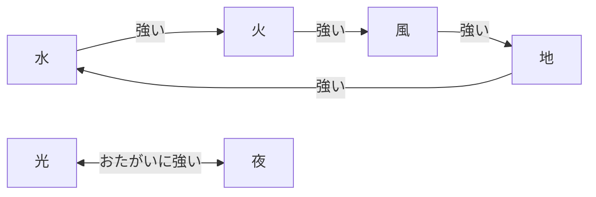

# ピクセル・バトラー ― ストーリーとレベル（決めたいきさつ）

2026-11-23 に、持ち主と話し合って決めたこと。段階2〜4（ログイン前提・属性と特性・レベル・ストーリーの最初の9章）は、同じ日に作った。
いまのしくみのまとめは [DESIGN.md](DESIGN.md)。この文書は、決めたいきさつと、手下の一覧・まだ決めていないことを残す。
このファイルはリポジトリといっしょに公開されるので、鍵・家族のこと・特別な写真の条件は書かない。

---

## 1. ねらい

- メインの遊び手から、「ストーリーモードで、ロボをレベルアップさせたい」という強い希望があった
- いまは、勝っても何も残らない。**勝つと自分のロボが育つ**ことで、遊び続ける理由をつくる
- 遊び手は「お話を読むより、**どんどん戦いたい**」。会話は短くし、戦う回数を多くする

## 2. 大事にすること（いまの決まりとの両立）

| 決まり | どうするか |
|---|---|
| 成長は**ストーリーの中だけ** | ふたりで対戦・コンピュータと対戦は、いままでどおり初期値（レベルなし）で戦う |
| ランクは写真で決まる | ランクは変えない。レベルは別に持つ（カードには「ランク C ・ Lv7」のように出す）。C ランクでも、育てれば戦える |
| 数字はサーバーが決める | レベルと経験値は、サーバーだけが書きこめる場所に置く。画面は「もとの数字 × レベルの倍率」で計算する |
| 負けても何も減らない | 経験値もレベルも、負けて減ることはない |
| スキルはまだ増やさない | 上がるのは数字（HP・SP・こうげき・ぼうぎょ）だけ |
| だれかのロボの公平 | 敵として出すときは、持ち主が育てたレベルは使わない（コンピュータと対戦だけに出し、みんな Lv1 の強さ。ストーリーの乱入はやめた） |

## 3. ログインが前提

- Pixel Battler は、**ログインして遊ぶ**ことを前提にする。トップページ（タイトル）だけは、ログインなしで見られる
- レベル・経験値・ストーリーの進み具合をクラウドに置くため。スマホが変わっても、続きから遊べる
- これからマイページも作りたい（名前やストーリーの進み具合は Firestore の `users/{uid}` に置ける）
- 変わること：
  - いまはログインなしで遊べる「コンピュータと対戦」とガレージが、ログインのあとになる
  - ログインしないで使う「このスマホの中のガレージ」は、いらなくなる（前にスマホで作ったロボは、ログインしたときにクラウドへ移すしくみがもうある）
  - 手元（`npm run dev`）では、これまでどおりログインなしで試せるようにする

## 4. 属性（5種類 → 6種類）

**地・水・火・風の4すくみ**と、**光・夜**。

| 属性 | 強い相手 | 子どもに説明するなら |
|---|---|---|
| 水 | 火 | 水は火を消す |
| 火 | 風 | 風は火をあおって、かえって大きくしてしまう |
| 風 | 地 | 風は岩や土をけずる |
| 地 | 水 | 土は水をせき止めて、すいこむ |
| 光・夜 | おたがい | いまと同じ |

- 倍率はいまと同じ：強いと 1.3倍、弱いと 0.77倍。向かい合わせの組（水と風・火と地）と、光・夜とほかの4つは 1倍
- 画面の名前は「夜」のまま（「闇」は小学校で習わない字のため）
- **いまのロボの移し方**：火・水・光・夜はそのまま。**森は地に移す**（木は大地に根をはる）。風は、これから作るロボから生まれる
- AI への説明（どんな写真が何の属性か）を書き直す。目安：地＝土・岩・山・木や森・金属・茶色や緑／風＝空・鳥・羽・雲・速いもの／水＝水・氷・海・青／火＝火・熱・赤／光＝光・金・白・電気／夜＝夜・影・黒・ふしぎなもの
- 作ったときのこと（2026-11-23）：設計図の中の名前は変えず、`verdant` の画面の名前を「地」にした（色も土の色に）。風は `gale` を足した。だから、前のロボの設計図はそのまま読める

## 5. 特性（8種類 → 10種類）

いまの8つ（先手・ど根性・つらぬき・自動回復・集中・鉄の守り・熱血・強運）に、二つを足す。

| 特性 | 効き方 | ねらい |
|---|---|---|
| **底力** | HP が3割より少なくなると、こうげき+40% | 「鉄の守り」（守りが上がる）と対になる。逆転の場面ができる |
| **見切り** | 12%の確率で、ダメージをかわす（はじめは 15% で考えたが、試すと強すぎた） | 「かわした！」の場面ができる。かわす動きと「ミス」の表示を作る |

- いまあるロボの特性は、そのまま。新しい二つは、これから作るロボに AI が付ける
- 数字は `npm run sim` で、ほかの特性と勝率がそろうように合わせる

## 6. レベル

### 上がり方

- **Lv1〜99**。経験値は、はじめは**勝つと一定の量**（どの敵でも同じ）にした。2026-11-25 に、**手下 10・ボス 20・ずっと下のレベルの敵は少し**に変えた（持ち主が選んだ「案F」。くわしくは [DESIGN.md](DESIGN.md) の6章「レベル」）
- レベルが上がるほど、次のレベルまでに要る勝利数が増える。**Lv99 まで約350勝**（下の表で合わせて364勝。1戦1〜2分で6〜12時間。よく遊ぶ子で1〜2週間）を目安にする

| レベル | 1レベル上がるのに要る勝利数（目安） |
|---|---|
| 1〜9 | 1 |
| 10〜19 | 2 |
| 20〜39 | 3 |
| 40〜59 | 4 |
| 60〜98 | 5 |

- 1章だけでのレベル上げも許す。レベルが上がるほど上がりにくいので、RPG で最初の場所で地道にレベルを上げるのと同じ感覚
- 経験値が入るのは、**勝ったロボだけ**

### 上がる数字

- **HP・SP・こうげき・ぼうぎょ**が、1レベルごとに **+3%**（Lv99 で約3.9倍）。自分のほうが10レベル上なら、はっきり楽に勝てるくらいの差
- **スキルに使う SP も、同じ割合で増やす**。バトルは SP まんたんで始まるので、SP だけが増えるとスキルを毎回使えるようになってしまう。いっしょに増やすと、SP の数字は大きくなる（強くなった感じは出る）のに、使える回数は今と同じ。毎ターンたまる SP（10・集中20・ガードで+15）も同じ割合で増やす
- **バトルの長さを変えない**：いまのダメージの式は `こうげき × … × 300 / (300 + ぼうぎょ)` で、ぼうぎょが大きくなるほど効きにくくなる形。数字をそのまま何倍にもすると、高いレベルではバトルが長くなり、25ラウンドの引き分けが増える。式の `300` もレベルの倍率に合わせて大きくし、Lv99 どうしでも Lv1 どうしと同じテンポにする（`npm run sim` で確かめる）
- 割合で決まるもの（回復・自動回復・ガードの回復・必殺ゲージ）は、そのままでよい

### データ

- ロボの入れ物（Firestore の `users/{uid}/robots/{写真の印}`）に `level` と `exp` を足す。書きこむのはサーバーだけ（いまのガレージと同じ決まり）
- バトルに勝ったら、画面がサーバーに知らせ、サーバーが経験値を足す
- ずるの歯止め（はじめはこれで十分。家族と友達が遊ぶため）：短すぎるバトルは数えない・同じ章の同じ敵に続けて勝った知らせは一度だけ数える、など
- もっとしっかりする方法：バトルの計算は画面から切り離した純粋な計算なので、選んだコマンドの記録をサーバーで再生して、本当に勝ったかを確かめられる。必要になったら入れる

## 7. ストーリー

### 形

- **99章**。各章に**5体の敵**がいて、**5連戦**で戦う
  - 1体ずつ戦い、勝つと次の敵へ。**HP は毎回まんたん**から
  - 負けたら、**負けた敵からやり直し**（勝った分は残る）
  - 5体目（ボス）に勝つと章クリア。次の章が開く
  - クリアした章は、何度でもやり直せる（レベル上げのため）
  - 2026-11-25 から：勝ったことのある敵は、えらんで何度でも戦える。前の敵ともう一度戦っても、たどり着いたところは下がらない（持ち主の希望）
- **章Nの敵は Lv 3N−2**（最初の9章は Lv1・4・7…25）。はじめは「Lv N」にしたが、1章を通すと Lv6 になり、3章から先がほとんど負けなかったので、2026-11-23 のリファクタリングで変えた（持ち主が決めた）
- 5連戦の途中で、**使うロボを1体ごとに選び直せる**。何体も育てている人に合わせる
- 会話は、**ボスと戦う前の一言だけ**（どんどん戦いたい、に合わせる）。10章から先の人物の章は、5人とも戦う前に一言を言う（2026-11-25、持ち主が決めた）
- 章の途中の進み具合（何体目まで勝ったか）は、サーバーに置いて、あとから続きを遊べるようにする

### 最初の9章

最初の9章は「地・水・火・風・光・夜・森・海・月」。10章から先は、人物の章（下の「10章から：人物の章」）。
ボスは、いまのコンピュータの敵9体の体（見た目）を生かし、名前・二つ名・属性を付け直す。

| 章 | 方向 | 属性 | ボス | 二つ名 | もとの体 |
|---|---|---|---|---|---|
| 1 | 地 | 地 | ドルガイア | 大地の門番 | ヴォルテクス（重い一つ目の人型） |
| 2 | 水 | 水 | シズクレア | こおれる湖の武道家 | フロスティア（すらりとした人型） |
| 3 | 火 | 火 | バーンハウンド | ほのおを走る番犬 | ガルフレア（四本足） |
| 4 | 風 | 風 | ゲイルビート | つむじ風の王者 | ホーンビート（羽のあるカブトムシ） |
| 5 | 光 | 光 | ピカリオン | 光の花火師 | ハナビート（空にうかぶ花火） |
| 6 | 夜 | 夜 | ジャックランプ | 夜のいたずら王 | パンプキッド（かぼちゃ） |
| 7 | 森 | 地 | バンブーン | 竹林の守り手 | タケランサー（竹の人型） |
| 8 | 海 | 水 | タイダロン | 深い海の守り神 | タートロン（海がめ） |
| 9 | 月 | 光 | ルミナス | 三日月の見はり番 | ルミナス（空にうかぶ。名前はそのまま） |

- 属性の数：地2・水2・光2・火1・風1・夜1
- 「コンピュータと対戦」に出る9体も、この新しい名前と属性にする（強さは初期値のまま）
- 体の色は、新しい属性に合わせて少し直すことがある

### 手下（各章の1〜4体目）

- 章ごとに**4体ずつ新しく作る**（最初の9章で**36体**）。その章のボスの手下として、章の雰囲気（地の章なら、岩・モグラ・石ころ…）をそろえる
- 強さ：レベルはボスと同じ（章の敵のレベル）で、もとの数字をボスより低くする（ランク C〜B くらい。ボスは A）。1体目から4体目へ、少しずつ強くする
- ロボは部品の組み合わせなので、1体を作るのは速い。設計図（名前・部品・色・技）は下書きを作り、**持ち主に見てもらってから**入れる

**下書き（2026-11-23。`src/game/minions.ts`）**：名前（もとにしたもの・二つ名）。属性は、太字が章とちがう属性で、ほかは章の属性。見た目は、手元で `?showroom&minions=1`（1章の4体とボス）で見られる

| 章 | 1体目 | 2体目 | 3体目 | 4体目 |
|---|---|---|---|---|
| 1 地 | モグラッド（モグラ・土の中のあなほり名人。**夜**） | イシコロン（火打ち石・火花をちらす石ころ。**火**） | ロックボア（いのしし・岩はだのいのしし） | ドグウガード（土の人形・大地の門の見はり番） |
| 2 水 | シズクン（雨のしずく・風にのるしずく。**風**） | ケロッパ（カエル・田んぼのジャンプ名人。**地**） | ユキダルン（雪だるま・雪原の見はり） | フロストガード（こおった湖・こおれる湖の兵士） |
| 3 火 | ヒトカゲン（トカゲ・火山の岩場のトカゲ。**地**） | マッチボー（マッチぼう・小さな火の兵） | ヤカンダー（やかん・お湯がわきたつやかん。**水**） | ヒバシラー（火柱・ふき上がる火柱） |
| 4 風 | トンボルト（トンボ・池の上のトンボ。**水**） | ワタゲン（たんぽぽのわた毛・野原のわた毛。**地**） | カザグルン（風車・くるくる風車） | ハヤブサー（はやぶさ・空をかけるはやぶさ） |
| 5 光 | ホタルン（ホタル・夏の夜のホタル。**夜**） | ピカデン（電球・あつあつ電球。**火**） | ミラーン（かがみ・光を返すかがみ） | ヒマワリオン（ひまわり・太陽を向く花） |
| 6 夜 | コウモリン（コウモリ・夜風にのるコウモリ。**風**） | クロニャン（黒ねこ・夜道の黒ねこ） | ホーホウル（フクロウ・森の夜番。**地**） | オバケット（おばけ・やしきのおばけ） |
| 7 森 | ドングリン（どんぐり・落ち葉の中のどんぐり） | キノコロン（キノコ・森のおくのキノコ。**夜**） | キツツキー（きつつき・木をたたく音。**風**） | クワガッツ（クワガタ・大あごのクワガタ） |
| 8 海 | クラゲン（クラゲ・光るクラゲ。**光**） | シオガニー（カニ・岩場のカニ。**地**） | タコスミン（タコ・すみをはくタコ） | シャークス（サメ・海の大きなサメ） |
| 9 月 | ダンゴロン（月見だんご・月見のおだんご） | ムーンラビ（月のうさぎ・月のうさぎ） | ホシクズン（星くず・夜空の星くず。**夜**） | メテオラン（流れ星・もえる流れ星。**火**） |

- **属性まぜ**（2026-11-23 のリファクタリングで、持ち主が決めた）：各章の4体のうち2体を、章とちがう属性にした（太字）。属性の相性がとても強い（同じ敵でも、属性しだいで勝率 3%〜96%）ので、章の属性に弱いロボでも勝ちやすい敵がいるように。1章の1体目は夜にして、どの属性のロボでも、1体目でレベル上げができるようにした
- 属性をまぜるのに合わせて、3章（トカゲを1体目に）と4章（トンボを1体目に）の順番を入れかえ、二つ名と紹介文・技を少し直した（例：ヒトカゲンの技は、火をはく「ほのおのいき」から、かみつく「ロックバイト」に）

### ボスの一言（下書き。`src/game/story.ts`）

| 章 | ボス | 戦う前の一言 |
|---|---|---|
| 1 | ドルガイア | ここは大地の門。通りたければ、力を見せてみろ！ |
| 2 | シズクレア | こおった湖の上では、だれも わたしに勝てない。 |
| 3 | バーンハウンド | ほのおより速く走れるか？ ためしてやる！ |
| 4 | ゲイルビート | つむじ風の王者が、相手をしてやろう！ |
| 5 | ピカリオン | さあ、光の花火大会の はじまりだ！ |
| 6 | ジャックランプ | ようこそ、夜のやしきへ。いっしょに あそぼうよ！ |
| 7 | バンブーン | 竹は折れない。何度でも 立ち上がる！ |
| 8 | タイダロン | 深い海の力、その身で 受けてみよ。 |
| 9 | ルミナス | 月の光の下で、さいごの しあいだ。 |

### 10章から：人物の章（2026-11-25。`src/game/thinkers.ts`）

持ち主と壁打ちして決めたこと：

- 10章から先は、**哲学・歴史・科学に関係した人物**が敵。**生まれた順**に、1章に5人（5人目がボス）
- 敵の**名前は人物の名前そのまま**。紹介文で「◯◯の考えから生まれたロボ」と書く（本や授業で名前に出会ったとき「ゲームで戦った人だ」とつながるように）
- **属性は人物の考えから決める**。同じ章の中で、ばらばらでよい（1〜9章の「手下2体は別の属性」は当てはめない）
- **5人とも、戦う前にせりふを言う**
- 強さの決まりは1〜9章と同じ：敵は Lv 3N−2（10章は Lv28）。手下は1体目から4体目へ少しずつ強く、ボスは同じレベルのランダムなロボの勝率が約50%。数字は `npm run tune:minions` で合わせる。ランクの表示は C・C・B・B・A
- 生まれた年は、古い人ほどはっきりしない（説によって数年〜十年ずれる）。順番は、よく言われる年で決める

**10章 ミレトスの港**（敵は Lv28）：港町ミレトスの3人と、向かいの島（サモス）のピタゴラス、近くの町のクセノパネス。ピタゴラスとクセノパネスは、のちに港から西（イタリア・シチリア）へ船出した、という話でつなぐ。ボスにエンペドクレスも考えたが、生まれた順（前494ごろ）ではパルメニデスより後なので、11章に回した

| | 人物（生まれ。紀元前） | 属性 | 二つ名 | 技 | 必殺技 | 特性 | 戦う前のせりふ |
|---|---|---|---|---|---|---|---|
| 1体目 | タレス（624ごろ） | 水 | 日食を言い当てた人 | ピラミッドはかり（強打） | エクリプス・ウェーブ | 先手 | すべてのもとは水だ！ 水がなければ、何も生まれない。 |
| 2体目 | アナクシマンドロス（610ごろ） | 夜 | はじめて世界地図をかいた人 | ト・アペイロン（のろい） | アペイロン・ノヴァ | 自動回復 | もとは水ではない。かぎりのない、ふしぎなものだ！ |
| 3体目 | アナクシメネス（586ごろ） | 風 | 空気をすべてのもとにした人 | こい空気・うすい空気（連打） | エア・トランス | 見切り | 口をすぼめて ふく息は冷たく、ハーッと はく息は温かい。すべては空気だ！ |
| 4体目 | ピタゴラス（570ごろ） | 光 | 数の力を信じた人 | 数のハーモニー（パワーアップ） | テトラクティス | 集中 | すべては数でできている。この戦いも、数で読みといてみせよう。 |
| ボス | クセノパネス（570ごろ） | 地 | 旅する詩人 | 牛と馬の神さま（カウンター） | アース・アンド・ウォーター | ど根性 | 牛や馬に手があったら、神さまを牛や馬の形にかくだろうよ！ |

- 属性は考えから：タレス＝水（すべては水）・アナクシマンドロス＝夜（かぎりのない、ふしぎなもの）・アナクシメネス＝風（すべては空気）・ピタゴラス＝光（数・星の調和）・クセノパネス＝地（すべては土と水から）
- 見た目は、手元で `?showroom&minions=10` で見られる

**11章の案**（まだ作っていない）：ヘラクレイトス（535ごろ）・パルメニデス（515ごろ）・アナクサゴラス（500ごろ）・エンペドクレス（494ごろ）・ゼノン（490ごろ。ボス）

### だれかのロボの乱入（やめた）

- はじめは、1〜4体目のどれかが 20% で「だれかのロボ」と入れかわる形で作った（強さは初期値 × その章のレベル）
- 2026-11-23 のリファクタリングで**やめた**（持ち主が決めた）。ほかの人のロボはボス並みに強く（勝率 約52%、S ランクなら約43%）、手下を1体目から4体目へ少しずつ強くした意味がなくなるため。だれかのロボは「コンピュータと対戦」だけに出る

## 8. 作る順番

段階ごとに本番に出せるように分ける。

1. **設計書**（この文書）
2. **ログイン前提・属性6種類・特性10種類**：いまのロボを新しい属性に移す。9体を新しい名前と属性にする。`npm run sim` で釣り合いを合わせ直す ― **2026-11-23 に作った**（くわしくは [DESIGN.md](DESIGN.md) の6章。見切りは 15% では強すぎたので 12% にした）
3. **レベルと経験値**：サーバーにレベルを置く。ダメージの式と SP を合わせる。カードに「Lv」が出る ― **2026-11-23 に作った**（くわしくは [DESIGN.md](DESIGN.md) の6章「レベル」。勝ったロボに経験値を足す窓口 `/api/robots/win` はあるが、呼ぶ画面は段階4で作る）
4. **ストーリー画面**：99章のしくみ・最初の9章・手下36体・ボスの一言 ― **2026-11-23 に作った**（くわしくは [DESIGN.md](DESIGN.md) の6章「ストーリー」。手下とボスの一言は下書き。乱入は、同じ日のリファクタリングでやめた）
5. **10章 ミレトスの港**（人物の章のはじめ。5人とも戦う前に一言）― **2026-11-25 に作った**

## 9. まだ決めていないこと

- **節目のごほうび**（見た目の進化など）：保留。もっと練る
- **11章から先**の中身（人物と章の名前。11章の案は上の「10章から：人物の章」）
- **手下36体**の名前・見た目・技（下書きを見てもらう）
- **ボスの一言**の中身
- **マイページ**の中身
- 二軍のロボを育てやすくする手当て（例：いちばん育っているロボより低いロボは、経験値が多め）
